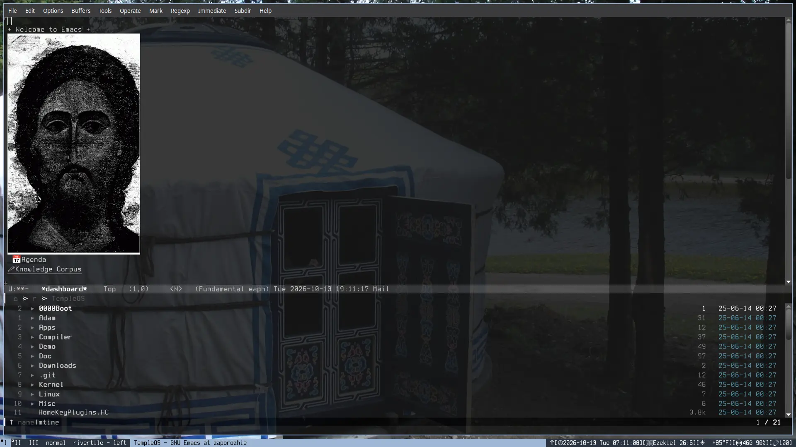

* Sober

#+ATTR_HTML: :width 640

Sober is my personal Linux meta-distribution oriented for general purpose
workstation work.
** Installation

Read the bootstrap bash script, then run it.

This is assumed:

1. You are on a typical GNU/Linux desktop.
2. You have access to root and sudo.
3. You have the bash shell.
4. You are on a fresh install specifically to use this.
5. You know what you are doing, and are prepared for the worst.

The script is not idempotent, nor designed to be, run it only once.

** Inventory

| Category                     | Software                                                       |
|------------------------------+----------------------------------------------------------------|
| Computing environment        | [[https://www.gnu.org/software/emacs/][GNU Emacs]]                                                      |
| Window manager               | [[https://codeberg.org/river/river-classic][river-classic]]                                                  |
| Package manager              | [[https://guix.gnu.org/][Guix]] (user install)                                            |
| Keyboard Layout              | Standard [[https://en.wikipedia.org/wiki/Dvorak_keyboard_layout][Dvorak]] + capslock = escape                            |
| Theme                        | [[https://github.com/mate-desktop/mate-themes/tree/master/desktop-themes/BlackMATE][BlackMATE]] + Kvantum Dark + Windows 7 Icons, the true theme.    |
| Terminal Emulator            | my [[https://st.suckless.org/][st]] fork                                                     |
| Shell (interactive use)      | [[https://fishshell.com/][fish]]                                                           |
| Shell (non-interactive use)  | [[https://www.zsh.org/][zsh]]                                                            |
| Text editor                  | Emacs + [[https://helix-editor.vercel.app/][Helix]]                                                  |
| Notes/Knowledge/Tasks/Life   | Emacs [[https://orgmode.org/][org-mode]]                                                 |
| Video editor(s)              | [[https://www.shotcut.org/][Shotcut]]/[[https://kdenlive.org/][Kdenlive]]/[[https://en.wikipedia.org/wiki/DaVinci_Resolve][Resolve]]                                       |
| Art                          | [[https://blender.org][Blender]]                                                        |
| Web Browser                  | [[https://librewolf.net/][Librewolf]] + [[https://www.torproject.org/][Tor]]                                                |
| Dynamic menu program         | [[https://github.com/Cloudef/bemenu][bemenu]]                                                         |
| Status bar                   | [[https://github.com/kolunmi/sandbar][sandbar]]                                                        |
| Image editor                 | [[https://www.gimp.org/][GIMP 3]] + [[https://github.com/Diolinux/PhotoGIMP][PhotoGIMP]]                                             |
| Image viewer                 | [[https://codeberg.org/NRK/nsxiv][nsxiv]]                                                          |
| Screenlocker                 | [[https://codeberg.org/ifreund/waylock][waylock]]                                                        |
| Audio editor                 | [[https://www.audacityteam.org/][Audacity]] + [[https://en.wikipedia.org/wiki/SoX][sox]]                                                 |
| Multimedia Utilities         | [[https://ffmpeg.org/][ffmpeg]] + [[https://imagemagick.org/][image magick]] + [[https://www.lcdf.org/gifsicle/][gifsicle]]                               |
| Scripting Languages          | [[https://www.sbcl.org/][sbcl]] + [[https://gforth.org/][gforth]] + [[https://www.tcl-lang.org/][tcl]] + [[https://github.com/hanslub42/rlwrap][rlwrap]]                                   |
| Virtualization               | [[https://www.qemu.org/][qemu]] + [[https://codeberg.org/knyz/leshy][leshy]]                                                   |
| Level Editing                | [[https://eureka-editor.sourceforge.net/][Eureka]] + [[https://trenchbroom.github.io/][Trenchbroom]] + [[https://www.blender.org/][Blender]]                                 |
| Spirituality                 | Emacs [[https://github.com/Zacalot/bible-mode][bible-mode]] + [[https://wiki.crosswire.org/Frontends:Diatheke][diatheke]] + [[https://codeberg.org/knyz/deacon/src/branch/master][deacon]]                           |
| Finance                      | [[https://hledger.org/][hledger]] + Emacs [[https://github.com/narendraj9/hledger-mode][hledger-mode]]                                   |
| Commandline Niceities        | [[https://github.com/ajeetdsouza/zoxide][zoxide]] + [[https://ivarch.com/programs/pv.shtml][pv]] + tree + [[https://ripgrep.dev/][ripgrep]] + scc + [[https://tldr.sh/][tealdeer]] + [[https://eza.rocks/][eza]] + fzf etc. |
| Calculator                   | [[https://qalculate.github.io/][qalculate]]                                                      |
| Archives/Compression         | [[https://7-zip.org/][7zip]] + [[https://gitlab.com/bgermann/unrar-free][unar]] + [[https://www.cabextract.org.uk/][cabextract]] etc.                                  |
| Download Management/Torrents | [[https://aria2.github.io/][aria2c]] + [[https://github.com/ukaszg/aria2/tree/master][Emacs aria2]]                                           |
| Data management              | [[https://rclone.org/][rclone]] + [[https://www.borgbackup.org/][borg-backup]] + [[https://docs.xfce.org/apps/xfburn/start][xfburn]] + [[https://syncthing.net/][syncthing]]                      |
| Version Control              | [[https://git-scm.com/][git]] + [[https://subversion.apache.org/][subversion]]                                               |
| Git Interface                | Emacs [[https://magit.vc/][magit]] + [[https://github.com/jesseduffield/lazygit][lazygit]]                                          |
| Multimedia Playback          | [[https://mpv.io/][mpv]] + [[https://www.gnu.org/software/emms/][EMMS]]                                                     |
| Recording                    | [[https://obsproject.com/][obs]] + [[https://github.com/ammen99/wf-recorder][wf-recorder]]                                              |
| Games 🤮                    | [[https://www.gnu.org/software/gnugo/][gnugo]] + [[https://www.nethack.org/][nethack]] + [[https://freedoom.github.io/][freedoom]]                                     |

** Not included

- Emacs configuration, these seem to be hyper-personalized
- Anki
- Resolve
- mocp

** History

This is a successor project to 'vilyaemsetup' which was a massive
repository that contained a script to bootstrap the system. That
project had a few problems that justified starting anew.

- It could only run on Devuan OpenRC in particular.
- The aesthetic was undecided, and previous themes bloated the
  repository with their phat binary assets.
- The scripts were janky..
- Packages were done completely in apt, and some using nix-profile, a
  very janky, and buggy way to do things, it was of course, not
  completely reproducible to the degree I deem acceptable.
- I now use Emacs and evil mode.
- I now use River + Wayland.
- I don't like dealing with GNU stow, using symlinks to store configs
  is just a /bad idea/.
- The install included proprietary software, that's bad mmmkayy?
- The install included development libraries, not just a few, no, a
  lot of them.
- There are too many directories in the repository, I would like it if
  were easy for anyone to navigate, keep it as flat as possible.
- I now have my wallpapers in webp, because I am *evil*, and torture Adobe™️users.

  
** More Info

Only contributions from via Codeberg or email will be accepted.

Website: https://vilyaem.xyz

Support this project:

XMR:48Sxa8J6518gqp4WeGtQ4rLe6SctPrEnnCqm6v6ydjLwRPi9Uh9gvVuUsU2AEDw75meTHCNY8KfU6Txysom4Bn5qPKMJ75w
        
WOW:WW2L2yC6DMg7GArAH3nqXPA6UBoRogf64GodceqA32SeZQpx27xd6rqN82e36KE48a8SAMSoXDB5WawAgVEFKfkw1Q5KSGfX9
    
Liberapay: https://liberapay.com/vilyaem/donate

*** License

Public Domain CC0.
